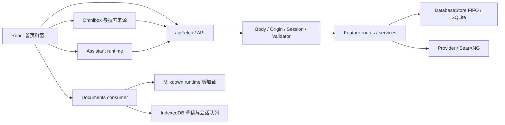

# Searcher 全系统消融与架构价值评估

## 1. Executive Summary

**结论：保留现有安全、持久化和无障碍机制；优先验证长文档编辑成本与大规模搜索，不依据本次微基准直接修改生产实现。** 本报告包含实际执行的受控模块级消融，但不是全系统端到端性能验收，也没有完成人体用户研究。

- **P0：长文档编辑。** 在真实 Chromium、非 React 的编辑流水线夹具中，20,243 字符时，加完整 Markdown 分析前后同步 dispatch 中位数为 11.6 → 38.9 ms；100,270 字符的完整分页流水线为 156.2 ms。分析在夹具中同步执行；生产 React 中具体调度和输入延迟尚未实测，不能把差值直接当作真实 INP。保存、草稿和冲突保护不可因此移除。
- **P1：大规模短词搜索。** 5 万篇合成笔记、热缓存的 SQL 副本中，双字中文扫描中位数 150.21 ms，5 万篇高频长词 316.13 ms。`LIKE` 变体在拉丁短词上更快，但含 NUL 字符的查询存在反例，且未覆盖分页、所有 SQLite 构建或完整 DTO；**不具备上线等价性**。
- **保留正确性机制。** 键盘、Escape、搜索分组和窗口几何的确定性消融产生可复现的契约反例；这些是边界价值而非用户频率或美感证据。移除搜索 owner 条件的模拟变体在四个合成条件下返回其他用户的行，绝不能作为优化。
- **AI 风险待验证。** mock Provider 测量中，五篇 20 万字符笔记产生约百万字符工具结果；合成检索查询的 AND 与 OR 在召回上有取舍，OR 丢失短词语义。没有真实模型、检索快照、答案质量、token 或费用实验，不能据此决定替换上下文或检索策略。
- **视觉风险待验证。** 计算模型给出亮色 status banner warning 4.46:1、success 4.48:1；没有真实页面 computed-style、合成背景及人工可读性确认。它是优先复核的潜在底线风险，不是已确认的实页缺陷。

决策标签中的 Keep 仅表示本次指定反例证明相关约束不可直接消除；Inconclusive 表示证据不足，不代表机制没有价值。本次没有实施产品重构。

## 2. Architecture Inventory



| 区域 | 实际职责、生命周期、源码依据 | 价值及边界 |
|---|---|---|
| 启动与请求 | `src/main.ts` 校验 origin、迁移、创建 auth/AI 并启动；`src/app.ts:69-95` 注册策略与路由；`src/internal/hono/`、`src/internal/validator/` 管请求体、鉴权与校验 | 安全边界不应以少一层为理由移除；资源文件与 SPA 的 404/缓存语义不同 |
| 数据 | `src/db/database.ts` 的 `DatabaseStore.run` 是 FIFO，`src/db/schema.ts`、`ai-schema.ts` 与 `drizzle/` 定义持久数据及迁移 | 同一进程串行写读的正确性约束，也限制仅通过 `Promise.all` 的并行收益 |
| 搜索 | `web/src/components/searcher/SearcherSearchInput.tsx`、`features/omnibox/{useOmniboxSources,omnibox-model,omnibox-keys}.ts`；`src/features/search/`、`src/features/documents/service.ts`、`src/features/bookmarks/service.ts` | 本地历史、联网、个人结果、命令及权限分组；短词扫描与长词索引语义不同，不是冗余的双实现 |
| 首页和窗口 | `web/src/app/SearchHome.tsx`、`features/windowing/{DesktopCoordinator,WindowFrame}.tsx`、`features/dock/`、`features/home-layouts/` | 窗口 Host 保存后台内容、路由、焦点；移动、最小化与关闭并非同一生命周期 |
| UI 系统 | `web/src/design-system/tokens.css`、`components/ui/` Base UI primitives、`components/searcher/semantic.tsx`、`scripts/ui-guard/` | Token、基础可访问交互与业务语义分层；包装是否可合并不能仅凭文件数判断 |
| 笔记 | `features/documents/{DocumentEditor.tsx,document-session.ts,document-pagination.ts}`、`features/markdown-editor/runtime.ts`；`NoteMarkdown.tsx` 为只读 | canonical 正文、队列、草稿和冲突由 consumer 管理；只读与编辑 runtime 有不同生命周期 |
| AI | `web/src/features/ask/assistant-runtime.tsx`、`useAskStream.ts`；`src/features/ai/{ai.route,service,client,tools}.ts` | Assistant UI 适配服务端分支、流、工具与 provider；工具和模型调用并非普通搜索的必要依赖 |
| 加载与测试 | `web/src/App.tsx` 的路由 lazy、`web/vite.config.ts` 的 manualChunks、`scripts/check-bundle.ts` 的静态闭包；`scripts/e2e/suites.ts` 登记测试集合 | 分包不等于懒加载；需同时看依赖闭包和浏览器请求。`web/e2e/` 测真实生产构建和隔离服务 |

潜在重复计算：`documentDisplayTitle` 与 `documentSnippet` 各自分析 Markdown；编辑 consumer 的分析与编辑 runtime 的序列化亦各自处理正文，但输出与时机不同，不能仅凭都处理 Markdown 就认定可以合并。状态方面窗口局部地址、Router 地址和设备草稿有不同生命周期；未找到足够证据支持合并它们。

## 3. Experimental Baseline

### 版本、环境与隔离

- 初始主工作区：`main`，HEAD **`33e0c1f7ebfca3373a68f7c66e9c4bd25d5b5de0`**；实验前 `git status --short --branch` 只有 `## main...origin/main`。忽略文件不属于此清洁性证明。隔离 worktree：`/home/aawei/searcher/.worktrees/ablation-study-20261102`，detached 同一 SHA。主工作区已有数据库、备份及其他 worktree 均未用于实验。
- Linux x86_64 7.0.0-38-generic，Intel Core Ultra 5 125H，`nproc` 8，内存约 15.1 GiB；Deno 2.9.8 / V8 15.0.245.2；编辑器夹具 Chromium headless 141.0.7390.37 / Playwright 1.56.1。主要版本来自 `deno.jsonc`：React 19.1.1、Vite 7.1.7、Milkdown 7.22.2、Drizzle 0.45.2、Hono 4.13.7；具体依赖锁在 `deno.lock`。
- UI 实验从固定 commit `git archive` 生成快照及独立变体；搜索与 AI 使用隔离 SQLite 夹具，编辑器使用独立 Vite 夹具。部分实验脚本最初只读主检出源码或依赖，未改业务文件；AI 第二轮改为读取固定 worktree。**搜索 fixture 的 SQLite `random()` 软删除不是种子控制，重建不会逐行一致**，已保留当次数据。测量期间有其他任务运行，不是隔离 CPU，延迟置信度受限。
- `deno task build` 成功，Vite 报构建 5.55 s；首次运行含依赖初始化，非冷/热启动比较。`deno run --allow-read --allow-env scripts/check-bundle.ts` 通过。`deno task test`：841 passed、51 steps、0 failed；这不是覆盖率百分比或完整 E2E。`NODE_ENV=test E2E_TIMEOUT_MS=5000 deno test -A --no-check web/e2e/markdown-editor-loading.test.ts`：1 test / 4 steps 通过，覆盖访客首页、笔记根页、Live/Source、实验室加载边界；不是完整 documents suite。

### 构建与测量口径

| 指标 | 实测 |
|---|---:|
| 首页静态 JS 闭包 | 858,750 B raw；275,021 B gzip level 9；3 个 JS 文件 |
| 首页入口 / React / UI chunk | 284,352 / 265,721 / 308,677 B raw |
| editor-vendor / assistant-vendor / Markdown parser vendor | 332,494 / 318,330 / 120,868 B raw |
| Shared editor async 静态闭包增量 | 461,177 B raw；141,430 B gzip，预算 153,600 B gzip |
| Ask 路由相对首页增量闭包 | 552,508 B raw；165,383 B gzip，8 个 JS 文件 |

完整每个 chunk 的 raw/gzip 在 [build.log](ablation-data/build.log)，静态闭包与门禁口径在 [bundle-gate.log](ablation-data/bundle-gate.log)。Vite 输出的 gzip 与门禁 level 9 数值不完全相同；上表统一使用门禁。文件体积不等于网络传输量，也不等于执行或首屏时间。

未测得可代表真实用户的冷/热首页启动、搜索 UI 延迟、窗口打开/切换、真实 DocumentEditor 首开/编辑、长文渲染内存、布局稳定性、任务完成时间和操作次数；下文实验夹具数值不能替代这些基线。完整 E2E、UI 实页矩阵、测试稳定性多轮和实际覆盖率未执行或未统计。测试日志：[unit-tests.log](ablation-data/unit-tests.log)。

## 4. Ablation Matrix

| ID | 实验对象 | Baseline | Variant | 核心指标 | 变化 | 可信度 | 建议 |
|---|---|---|---|---|---|---|---|
| A1 | 文档短词 SQL | `instr(lower())` SQL 副本 | `LIKE ... ESCAPE` | 5 万篇拉丁短词 p50 | 150.01 → 44.96 ms，−105.05 ms / −70.0%；NUL 不等价 | 中低：单机、热缓存、SQL 副本 | Inconclusive |
| A2 | 个人搜索调度 | 笔记、应用顺序等待 | `Promise.all` | 5 万篇短中文 p50 | 144.529 → 141.514 ms，−3.015 ms / −2.1% | 低：FIFO、合成负载 | Inconclusive |
| A3 | 用户隔离 | FTS 带 owner 过滤 | 去掉该过滤 | 跨账号结果 | 4 个夹具/查询组合各出现 1 条外部行 | 高：反例，非性能优化 | Keep |
| A4 | 编辑正文分析 | 序列化 + session + 草稿 | 再加同步模拟分析 | 20,243 字符 dispatch p50 | 11.6 → 38.9 ms，+27.3 ms / +235%；更小更好故收益率 −235% | 中低：真实模块夹具，非 React | Inconclusive，P0 验证 |
| A5 | 编辑分页 | 完整分页视图 | 连续视图，保留插件 | 首帧代理 p50 | 46.1 → 41.4 ms，−4.7 ms / −10.2%；布局约 5 → 1 次/键 | 低：产品取舍、headless | Keep 能力；优化待测 |
| A6 | 搜索键盘与分组 | IME/权限/排序守卫 | 单项删除 | 决策表违规 | IME 0 → 384/6144 状态；401 门控 0 → 8/78 场景 | 中：纯函数 oracle，非浏览器 | Keep |
| A7 | Escape 与窗口几何 | 层栈快照、几何夹取 | 单项删除 | 同一事件重复关层 / 越界 | host 多关闭 0 → 1；几何 0 → 11,303/20,000 | 中：合成确定性边界 | Keep |
| A8 | AI 文档查询语义 | 全词 AND + 真实 service | OR/bm25 ID 查询 | 合成目标 recall@5 | 10k 自然语言 0.40 → 1.00；双字 0.167 → 0 | 中低：查询语义不同、输出不等价 | Reconsider，须产品决策 |

小样本百分比是对实测中位数的算术描述，不是置信区间。跨模块或跨工作负载的百分比不可相加。

## 5. Detailed Findings

### A1 — 短词匹配机制

- **假设与设计**：现状 `src/features/documents/service.ts:1395-1536` 为短词使用 `instr(lower(...), lower(...))`；复制其 SQL，并仅将短词谓词改为转义 `%`、`_`、反斜线的 `LIKE ... ESCAPE`。每轮轮换变体顺序，预热 3 次、测 30 次；固定 `limit=5`，对比真实服务与副本的 top-5 ID。测试 1k、10k、50k、长正文及 5k 应用夹具，包含其他 owner 和软删除行。
- **原始与统计**：50k 拉丁短词副本 p50 150.01 ms、p95 198.71 ms，变体 p50 44.96 ms；中文双字 150.21 → 119.29 ms，差 −30.92 ms / −20.6%。10k 拉丁 26.35 → 8.74 ms。所有本次 top-5 ID 对照一致；30 万对**不含 NUL**字符串的差分也是 0 分歧。完整逐轮样本与 p95 见 [search 原始结果](ablation-data/search/results/results-1793584458490.json) 和 [summary](ablation-data/search/logs/summary.txt)。
- **关键反例**：本机 SQLite 实测 `instr(lower('a\\0target'),lower('target')) > 0` 为 1，`'a\\0target' LIKE '%target%' ESCAPE char(92)` 为 0（此处 `\\0` 表示实际 NUL）。查询校验、正文、游标、Unicode/ICU 及排序均须证明完整等价；不能以这组样本声称普遍等价。SQLite 3.53.2 与其他构建可能不同。
- **决策**：Inconclusive。若继续，应先保留字面子串、大小写、owner、删除、游标和 DTO，补 NUL 与 Unicode 边界，再以真实 service A/B/A 测冷/热及生产分布；不可只优化 SQL 副本。

### A2 — 个人搜索并发调度

- **假设**：`src/features/search/personal.ts` 顺序读取笔记与应用；把两个真实 service 调用放到 `Promise.all` 是否缩短延迟。两者输出逐条对比、每变体 3 次预热和 30 轮轮换，固定同一数据库。`DatabaseStore` FIFO 仍序列化数据库任务。
- **结果**：50k 短中文 p50 144.529 → 141.514 ms，−3.015 ms / −2.1%；高频长词 296.254 → 293.796 ms，−2.458 ms / −0.8%；10k 高频词反而 60.112 → 64.635 ms，+7.5%。无独立进程 A/B/A 或置信区间。只证明此夹具下没有稳定的明显收益，不证明所有场景无收益。
- **决策**：Inconclusive；保留原调度。外部建议的历史与桩网络并发在固定 25 ms 延迟下 26.827 → 26.039 ms，非真实网络，不应据此改架构。

### A3 — FTS owner 约束与短词回退

- **假设**：去掉 `documents_fts.user_id` 或短词扫描是否安全。实验在隔离 SQL 副本故意删除单个条件，只用于寻找反例，不作为可部署变体。
- **结果**：移除 owner 条件后，`m10k/long-common`、`m10k/cjk3-rare`、`l50k/and2-long`、`xlbody5k/long-rare` 的 top-5 各含 1 条其他账号行；去掉短词扫描时 `short2-cjk-rare` 的 5 条结果降为 0。前者泄露隐私，后者破坏中文短词契约。删除 `deleted_at IS NULL` 虽在夹具中一致，却依赖 FTS 同步触发器，不是普遍等价。
- **决策**：Keep owner 过滤及短词能力；不要以削减权限或召回获得性能。历史迁移、损坏/重建索引以及并发写入仍须专门验证。

### A4 — 序列化、会话与正文分析

- **假设**：区分编辑事务、序列化、会话/设备草稿及 Markdown 分析的成本。真实 `createMarkdownEditor`、document session、IndexedDB 与 `analyzeDocumentMarkdown` 组成非 React 流水线；20,243 字符、227 个块，真实键盘按键，5 个 rep，每 rep 45 键，前 5 键预热丢弃，配置顺序轮换。
- **原始汇总（ms，dispatch p50 / p95）**：裸编辑器 0.70 / 1.10；加序列化 12.80 / 26.80；再加 session 和 IndexedDB 11.60 / 23.00；再加分析 38.90 / 73.20。各 rep 的分析配置中位数是 32.8、32.3、42.5、40.8、47.7 ms，波动明显。100,270 字符完整分页 p50 156.2、p95 198.5；300,373 字符 825.4、1452.9。完整原始逐键样本与逐 rep 汇总见 [editor/results](ablation-data/editor/results/)。
- **限制**：夹具用同步订阅器模拟 React `useMemo`，并非生产调度；去掉 `onChange` 也移除了依赖它的下游，不是单因素替代；输入由脚本产生，不含 IME、真实 PATCH、冲突或 React 重渲染。IndexedDB 改内存的 dispatch 37.0 → 37.0 ms 只说明此测量同步路径无差异，不能证明草稿无成本，更不能去掉草稿。各因子时序和缓存可能交互。
- **决策**：P0 检查是否可增量分析、缓存或调整调度；保留序列化和恢复语义。必须在完整应用比较固定正文、光标、composition、撤销、保存、409、账号切换和恢复，测真实输入到下一帧、长任务和结果一致性，才可判断方案。

### A5 — 分页与连续排版

- **设计**：同一 20,243 字符编辑夹具留一法，完整分页 vs 连续视图（插件仍在），各 5 rep、45 键、5 键预热。分页是用户选择的功能，因此此比较是**产品取舍 / 成本分解**，不是等价优化。
- **结果**：dispatch p50 37.0 → 37.4 ms；首帧代理 46.1 → 41.4 ms，差 −4.7 ms / −10.2%；分页约 5 次布局 / 键、1,845 次 DOM 几何测量，布局总中位数 10.1 ms，连续视图约 1 次布局。首帧代理为 keydown 到首帧后的宏任务，受约 16.7 ms vsync 量化，并非 INP。完整页数来自插件快照，未与打印比对。
- **决策**：保留分页、打印、选区与撤销。可研究合并测量或增量重排，但必须比较首尾及连续手动分页、长段落/表格/图片、字号与视口变化、IME 和实际打印；不得以关闭分页宣称等价提速。

### A6 — 键盘与分组状态消融

- **设计**：`omnibox-keys.ts` 枚举 6,144 个合成状态，对照按 `docs/workspace.md` 编写的独立规则；`omnibox-model.ts` 使用 78 个查询/登录/模型组合。逐个修改 IME、Escape、401、分组上限或排序。变体与 oracle 在 [ui/scripts](ablation-data/ui/scripts/)；[exp1](ablation-data/ui/results/exp1-keys.json)、[exp2](ablation-data/ui/results/exp2-model.json) 保留结果。
- **结果**：去 IME 守卫：违规状态 0 → 384；Escape 不检查列表状态：0 → 256；去 401 门控：个人组不应显示的场景 0 → 8；去网页去重：0 → 18。改变 `/settings` 裸命令解释、AI 模型门控和分组次序也改变现有产品契约。这些是构造状态数量，不是出现概率、真实任务成功率或用户数量。
- **决策**：Keep 这些契约。一个 IME Enter 的内部返回类型消融在当前夹具无效果，但未验证浏览器组合输入和所有调用者，不能据此删分支。需实页验证 combobox、焦点、读屏、IME 与触屏。

### A7 — Escape 层与窗口几何

- **设计与结果**：对 `components/ui/escape-layer-stack.tsx` 提取的类使用模拟事件；去掉 capture 快照后，同次 Escape 的 host 误关闭从 0 → 1。对 `WindowFrame.tsx` 提取的几何函数用固定种子 20261102 生成 20,000 个矩形；去尺寸夹取后越界 0 → 11,303，去位置夹取后 0 → 19,397。脚本切片不是整组件，输入分布不是生产流量。[exp3](ablation-data/ui/results/exp3-escape.json)、[exp6](ablation-data/ui/results/exp6-window.json) 保留具体反例与计数。
- **协同**：快照与层优先级一起避免自关闭导致的事件穿透；矩形初始值经 `project` 才在工作区内。某些重复 IME 检查可在所测路径互相覆盖，但移除全部后合成期间会处理事件，不能从单路径冗余推断可删除。
- **决策**：Keep；任何简化需浏览器验证 portal、同事件卸载、不可取消事件、焦点恢复和不同 Host 尺寸。

### A8 — AI 检索与上下文

- **假设与对照**：在合成语料测试 `DocumentsService.search` 全词 AND 与实验 SQL OR/bm25。每规模 30 个植入目标，每查询 15 次；500、2,000、10,000 篇。OR 直接返回 ID，真实 service 返回摘要 DTO，且 OR 丢弃短于 3 字符词；因此**不是等价实现，延迟不能对比**。
- **结果**：10k 自然语言带 filler 的目标 recall@5 0.40 → 1.00（+0.60，+150%）；双字查询 0.167 → 0（−0.167，−100%），该双字夹具中 30 个目标共用词且只取 5 条，0.167 是定义上的上限，不表示整体召回差。无空格中文问句两者均 0。两次构建语料的召回结果一致；原始命中见 [AI raw](ablation-data/ai/raw/) 与 [worktree 重跑](ablation-data/ai/raw_worktree/)。延迟统计的原始每次样本未全部保存，且运行时其他任务并发，不适合作精确性能结论。
- **上下文辅助观测**：`AiService.streamChat` 对进程内 mock provider 的请求随分支增长；60 轮合成消息上游约 76,493 bytes。5 篇每篇 200k 字符的工具结果约 1,001,356 字符；后续请求未重放 tool role。这不是模型质量或 token 成本测量。Provider 调用、外部搜索和敏感数据均未访问；不同 provider 随机性尚未控制。
- **决策**：Reconsider 检索语义和上下文预算，不能直接用 OR 或截断替代现有契约。需先冻结真实授权语料及检索快照，统一模型/参数，测相关性、引用准确性、成功率、token、耗时与成本；为短词、中文、owner、正文完整性和后续追问设非劣化门槛。

## 6. Optimization Roadmap

| 优先级 | 范围、决策 | 预期收益与风险 | 启动/验收条件 |
|---|---|---|---|
| P0 | 完整应用长笔记编辑：分析和序列化的增量/调度实验；Inconclusive | 夹具显示明显 CPU 成本；异步结果过期、IME、selection、正文与草稿完整性风险高 | 真实服务和浏览器 5k/20k/100k/300k，冷/热分离，至少 10 次独立交错运行；保存、冲突、恢复、版本、账号隔离零回归 |
| P0 | 实页核验亮色 status banner 对比度；Inconclusive | 合成计算 4.46/4.48 接近或低于 4.5；计算未证实页面背景与混色 | computed style、合成最终背景、light/dark、实际状态截图、文字 ≥4.5:1；必要时依 UI Contract 修订 |
| P1 | 搜索短词/高频词；Inconclusive | 合成规模下明显扫描成本；`LIKE` 已发现 NUL 反例，不能直接切换 | 先定义支持的输入、cursor、排序和所有 SQLite 运行时；真实 service 的冷/热 A/B/A，跨 owner、删除和分页零差异 |
| P1 | 分页测量批处理或增量重排；Keep 功能 | 夹具分页首帧代理多约 4.7 ms，长文更大；改变测量可能破坏跨页选区和打印 | 完整文档 E2E、同一编辑器和 undo、打印、IME 与响应式矩阵；记录每帧布局和内存 |
| P1 | AI 工具结果大小与检索召回；Reconsider | 合成结果可能带来上游体积；摘要或截断可能丢失必要依据 | 先确定模型和产品语义，固定查询/语料/工具/检索快照，人工盲评答案和引用，记录真实 token 与成本 |
| P2 | 首页末行平衡、材质与动效 | 纯布局 3,680 配置中去平衡使孤项 10 → 48，无法证明偏好或任务收益；动效/blur 未做实页性能消融 | 390/768/1440 × light/dark、壁纸与 Host 边界；实色、动效分别单变量；盲测易读性与任务完成，不以 Agent 审美评分 |
| P2 | 组件包装、窗口和状态归属 | 当前各自管理行为、可访问性与生命周期；没有维护成本实验 | 对单个等价替代做消费者、键盘、焦点、错误和回退验证，再讨论 Simplify/Merge，不以代码行数为结果 |

## 7. Reproduction Guide

### 基线

```sh
git rev-parse HEAD
git status --short --branch
# 在单独 worktree、不要指向真实数据库
 git worktree add --detach /tmp/searcher-ablation-baseline 33e0c1f7ebfca3373a68f7c66e9c4bd25d5b5de0
cd /tmp/searcher-ablation-baseline
deno task build
deno run --allow-read --allow-env scripts/check-bundle.ts
deno task test
NODE_ENV=test E2E_TIMEOUT_MS=5000 deno test -A --no-check web/e2e/markdown-editor-loading.test.ts
```

依赖 Deno 2.9.7+、已安装 Playwright 1.56.1 Chromium 和足够临时磁盘。构建不得与使用同一产物的 E2E 并发；本报告 E2E 是限时全部通过，仅代表上述四步。生产数据库、真实用户及现有备份不得用于复现。

### 已保留的实验

本次原样材料随报告保存在 [ablation-data](ablation-data/)；其中脚本包含本机**绝对路径**，不能直接在其他机器或 checkout 原封不动运行，必须先将脚本中的 `/home/aawei/searcher` 和实验目录路径改为自己的隔离副本，保持同一 SHA 与锁文件。修改实验脚本副本，不修改产品源码。命令、原始结果与日志保留了当次运行口径；不要把重新运行覆盖掉已有结果。

1. **UI 确定性消融**：将 [ui/scripts](ablation-data/ui/scripts/) 与 `run-all.sh` 复制到新的实验目录，调整脚本内 `EXP`、`REPO` 和 `build-variants.ts` 的 `ROOT`。`run-all.sh` 会**删除其指定的 `base` 目录并覆盖 results**，必须指定新建空目录；它从 commit archive 重建变体。运行 `bash run-all.sh`。本次两次重跑结果 SHA256 一致，校验文件在 [results/SHA256SUMS](ablation-data/ui/results/SHA256SUMS)。这是计算重复，不是独立用户或浏览器重复。
2. **搜索 SQL 消融**：在新目录复制 [search](ablation-data/search/)，改各脚本中源代码路径为基线 worktree，设置只读 `drizzle` 链接；`ROUNDS=30 ./run.sh`、`deno run -A --no-lock --config deno.search-study.json equiv.ts`、`deno run -A --no-lock --config deno.search-study.json markdown-cost.ts`、`python3 summarize.py`。首次自动构造 1k/10k/50k/5k 大正文及 5k 应用数据，需约 1 GB 磁盘。原始数据库保留于 `/home/aawei/experiments/search-study/data/`；由于生成时 SQL `random()`，重建不逐行相同，若要复现确切数据应**复制**这些 fixture 到新目录后运行，不要修改原件。所有这些数据均为合成数据。
3. **编辑器 Chromium**：复制 [editor](ablation-data/editor/) 到新目录，将配置和 import 的绝对路径指向同 SHA 隔离 worktree，使用该目录的 Playwright/Vite 依赖。先执行 `node <worktree>/node_modules/vite/bin/vite.js build --config vite.config.mjs`；依次 `node driver.mjs ladder --reps 5 --keys 45 --warm 5`、`node driver.mjs loo --reps 5 --keys 45 --warm 5`、`node driver.mjs burst --reps 5 --keys 45 --warm 5`、`node driver.mjs size --reps 4 --keys 30 --warm 4`，再用 `node analyze.mjs results/<名称>.json` 汇总。`run_all.sh` 的 size 默认参数与本次不同，以上命令才是本次口径。`deno run -A --no-lock --config <worktree>/deno.jsonc microbench.ts` 为纯函数测量。结果按键级数据、摘要和 SHA 均已保存；不可把此夹具称为完整 React E2E。
4. **AI mock 对照**：复制 [ai](ablation-data/ai/) 到新目录，修改 `run_all.sh`、脚本 import 和输出目录的绝对路径指向固定 worktree、独立临时数据库，设置新 `RAW_DIR` 后运行脚本。`raw/` 是首次只读主检出源码，`raw_worktree/` 是固定 worktree 重跑；Provider 完全 mock，不能从中推算真实模型质量或费用。E1 的 OR 是实验 SQL 语义替代，不是完整 service。
5. **NUL 反例**（在任何 Deno 2.9 环境运行）：

```sh
deno eval 'import { DatabaseSync } from "node:sqlite"; const d=new DatabaseSync(":memory:"); console.log(d.prepare("select instr(lower(?),lower(?)) > 0 as a, ? like ? escape char(92) as b").get("a\0target", "target", "a\0target", "%target%"));'
```

本环境输出 `a: 1, b: 0`。这只证明该环境的反例；其他 SQLite 配置需独立核对。

### 下一轮统计设计

按独立进程及隔离数据库/浏览器上下文执行，固定语料、视口、时区、颜色、设备比例与 CPU 条件，报告实际机器负载。将冷启动、热启动、缓存命中/未命中分开；每配置至少 10 个独立重复并交错 A/B/A，保留所有单次值、p50/p95、配对差、中位数差及 bootstrap 95% 区间；观测数不足时不报告稳定百分比。对分页 × 文档长度、缓存 × 重复查询做组合实验，不将单变量归因跨条件外推。测试 UI 需覆盖 390/768/1440 和相关 Host 阈值；所有候选先满足 `docs/design/UI_CHECKLIST.md` 底线。

## 8. Unverified Hypotheses

- **真实产品性能**：本次没有真实 React 编辑首开、输入 INP、窗口打开/切换、搜索键入到结果、长文渲染内存及缓存命中率；无真实用户任务时间/点击数或可靠设备分布。编辑夹具没有 React 和真实网络，搜索 SQL 副本不是完整服务；不可外推数字。
- **视觉与可访问性**：没有模糊 vs 实色或动效 vs 即时切换的实页 A/B、截图矩阵、CLS、焦点/触控全路径和人工阅读验证；不能证明美感或操作负担变化。拟采用随机顺序、隐藏方案名称、同任务同壁纸的受试者盲测，收集任务完成率、时间、错误与可读性；尚未实施。状态色计算需实页复核。
- **安全与等价**：`LIKE` 对 NUL 已不等价；30 万对有限样本不证明 Unicode、分页、SQLite 构建或所有合法输入等价。个人搜索 `Promise.all` 的无收益仅适用于测量的队列与负载。生产代码没有做变体后的全套回归。
- **AI**：未运行真实 provider、真实 SearXNG 快照、模型随机性控制、引用正确性评价或 token/费用测量。mock 流中的截断、重复 tool-call ID 等行为仅是合成兼容性风险，需要针对真实 provider 协议验证。检索语义变化属于产品取舍。
- **缺失性能证据**：未开展完整 UI 材质、动画、只读渲染替代、动态导入 eager 对照、缓存命中/未命中和组合交互实验；没有完整 5–8 项真实用户级性能 A/B，也没有完整系统级因果结论。此报告的 8 项为模块级机制对照和反例，不将其冒充完整全系统消融。
- **维护性与重复职责**：没有受控的修改任务、缺陷率或维护时间研究；任何 Simplify、Merge、Replace 均暂不推荐。长文分析和摘要处理看似重复，但其输出、时机和安全边界不同，需先证明等价。
