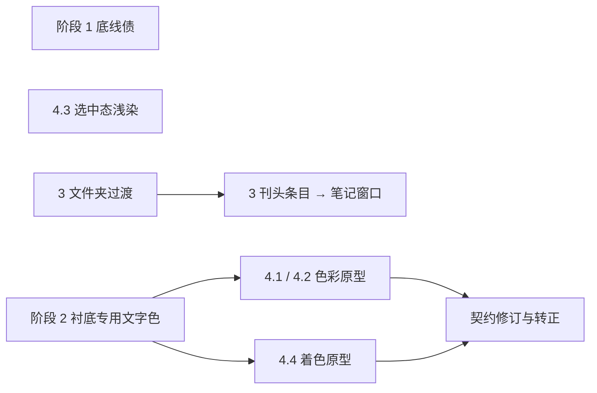

# 视觉语言演进：实施计划

状态：决定已确认（2026-11-10，见[已确定](#已确定)），跟踪 Issue #394。已实施：阶段 1（1.1–1.5）、阶段 2.1、阶段 3 第一步（文件夹）与 4.3；2.2 实测与 4.1 / 4.2 / 4.4 原型（`/design-lab/palette`）见各节，转正待人类在原型上选定；阶段 3 第二步只在 `/design-lab/motion` 验证，未进入生产。依据 2026-11-10 对视觉语言演进方向的讨论；窗口内容的刊头排版已另行实施（[EDITORIAL_WINDOWS_PLAN.md](EDITORIAL_WINDOWS_PLAN.md)），不在本计划内。现行规则以 [Visual Language](../design/VISUAL_LANGUAGE.md) 为准；本计划转正的部分须同步修订该契约。

## 现状基线（HEAD `383bd0e`）

| 来源                    | 事项                                                | 现状                                                                                                                                                                                       |
| ----------------------- | --------------------------------------------------- | ------------------------------------------------------------------------------------------------------------------------------------------------------------------------------------------ |
| 2026-10-26 审计 F01–F08 | 复合行容量、门禁漏检、Lab 样本、Dock 方向、契约漂移 | 已收敛（F06 经 #326 关闭；F05 的 `route-style-admin-lab.test.ts` 本次未重跑）                                                                                                              |
| 审计 F09 / #324         | 四个无消费者的 elevation Token                      | 未处理：`tokens.css` 的 `--elevation-note-drag`、`--elevation-dev-inspector`、`--elevation-card`、`--elevation-local-6` 无任何引用                                                         |
| #373                    | 2.5.7 拖拽替代                                      | 应用网格排序、笔记侧栏 / 大纲调宽、任务栏悬浮球位置均无不需要拖拽的单指针路径（键盘路径已有）                                                                                              |
| 底线已知缺口            | 笔记侧栏 A2                                         | `documents-workspace.css` 中精细指针 + ≥640px 的 28px 规则排在粗指针 44px 规则之后，触屏笔记本上被覆盖；`touch-targets.test.ts` 不覆盖侧栏                                                 |
| 底线已知缺口 / #370     | 宽屏刊头衬底 1.4.3                                  | `--muted` 与强调色小字在衬底上低至 2.5:1（浅）/ 3.8:1（深）；`glass-contrast.test.ts` 对衬底 `--muted` 只断言 3:1 探针；`wallpaper-readability.test.ts` 只取样窄屏露出区，不取样 1440 衬底 |
| 合成模型风险            | 玻璃表面 `--muted`                                  | Floating `dark/regular` 极值背景约 4.18:1、`light/clear` 约 3.62:1，未经实页测量                                                                                                           |
| 共享元素过渡            | 契约与 `lib/shared-element.ts` 已就绪               | 生产只有首页行内 AI 回答展开为会话（`InlineAnswerCard.tsx`）一处使用                                                                                                                       |
| 强调色浅染              | `--accent-soft` / `--accent-subtle`                 | 已用于表格选中行、任务栏活动项、标题栏按下的切换按钮、拖放目标；`--accent-border` 无生产消费者                                                                                             |
| 壁纸派生画布            | `--canvas-derived*`                                 | 只有 `glass-contrast.test.ts` 消费，生产无页面使用                                                                                                                                         |
| 图标描边                | Lucide 默认 2                                       | #369 D4 已决定保持 2                                                                                                                                                                       |

## 阶段与依赖

阶段 1、3 与 4.3 互不依赖，可并行交付。4.1 / 4.2 改动中性色或衬底底色，4.4 会在刊头分节上加浅染，三者都必须在阶段 2 之后进行，并保持阶段 2 新增的断言通过。每项单独成 PR，可独立回滚。

## 阶段 1：底线债（无风格决定）

### 1.1 应用网格单指针排序（#373 第 1 项）

- **改动**：`components/searcher/AppMenuItems.tsx` 增加同级“上移 / 下移”，首项 / 末项禁用；复用 `onMoveByKey` 的排序与持久化路径，文件夹内应用同理。与任务栏、刊头、笔记树的菜单用词一致。
- **验收**：右键、触屏长按菜单均可完成上移 / 下移；首页固定顺序与应用窗口顺序各自持久化；e2e 覆盖精细与粗指针。
- **实施说明**：网格图块没有 `⋯` 入口，未为此新增；应用窗口搜索结果的 `⋯` 不提供排序（过滤结果的邻项与实际顺序不对应）。首页与应用窗口共享应用库顺序（首页为固定项子序列，见 `docs/apps.md`），两处的移动都写入同一顺序。
- **文档**：`docs/apps.md`；`VISUAL_LANGUAGE.md`「验证与已知缺口」删去该项。

### 1.2 侧栏与大纲调宽的单指针替代（#373 第 2 项，D2）

- **改动**：在共享的 `PaneResizeHandle` 内实现，两个消费者（`DocumentsWorkspace.tsx`、`DocumentEditor.tsx`）不各自实现。分隔条提供菜单（右键、触屏长按，以及聚焦后 Shift+F10 / 菜单键），项为“窄 / 默认 / 宽”三档预设，当前档带勾号；三档取值由各消费者在既有最小 / 最大宽度内给出，Host 容不下时按现有临时夹取处理，不改写存储值。保留现有键盘语义与双击复位，账号 / 设备隔离不变。
- **验收**：两处分隔条都能不拖拽地调到三档宽度；e2e 覆盖精细 / 粗指针、刷新后保留，以及 Host 过窄时的夹取与恢复。

### 1.3 任务栏悬浮球位置的单指针替代（底线缺口，追加到 #373）

- **改动**：在悬浮球菜单提供“停靠左侧 / 右侧”和纵向位置预设，写入与拖动、方向键相同的本地布局；做法对齐窗口的位置预设菜单。
- **验收**：单指针完成换边与纵向调整，刷新后保留；`dock.test.ts` 扩展。

### 1.4 笔记侧栏触屏笔记本命中区（A2）

- **改动**：按[默认交互实现](../design/VISUAL_LANGUAGE.md#默认交互实现)中“纵向紧邻的列表条目改为可见放大到 44”的既有规则，让 28px 紧凑规则不再覆盖存在粗指针时的 44px，owner `documents-workspace.css`。#369 D6（侧栏条目高度保持不同）只约束精细指针下的可见高度，不受影响。
- **验收**：`touch-targets.test.ts` 加入侧栏固定入口与列表条目（鼠标 / 触屏笔记本 / 触屏）；契约中的 A2 已知缺口删除。

### 1.5 删除无消费者的 elevation Token（F09 / #324）

- **改动**：删除四个定义；其余 z-index 数字不动。
- **验收**：`deno task check:ui`、构建通过；纯删除，不需实页矩阵。

## 阶段 2：对比度缺口（D1：衬底专用文字色）

### 2.1 宽屏刊头衬底

- **改动**：衬底的混合比例与模糊不变，壁纸透感保持现状。为衬底上的次要文字与强调色文字新增专用 Token（命名示例 `--masthead-muted`、`--masthead-accent-text`），浅色主题更深、深色主题更亮，owner `tokens.css`，消费者为 `home-masthead.css` 中落在衬底上的星期、计数、时间、来源、导语与分节标题、序号、“全部笔记”。
  - 次要文字为静态取值，以衬底在极值壁纸上的最不利合成色为背景求出。
  - 强调色文字须覆盖九种预设与壁纸派生两种来源：预设在 `tokens.css` 逐项给出衬底取值；壁纸派生由 `design-system/wallpaper-accent.ts` 额外求解一个满足衬底约束的明度，与现有 `--wallpaper-accent*` 一同写到 `<html>`。高对比主题沿用其高亮取值，只在对比度不足时调整。
  - 窄屏收起态（直接印在壁纸上、已有描边与光晕）不使用这组 Token，保持现状。
  - 这是新增的系统级语义，在契约的 [首页刊头](../design/VISUAL_LANGUAGE.md#首页刊头home-masthead) 与「强调色用途」中登记 owner 与验证方式。
- **验收**：
  - `wallpaper-readability.test.ts` 新增 1440 宽屏刊头衬底取样，沿用现有覆盖率 / 5% 分位方法，七张极值壁纸 × 四主题，`--muted` 与强调色小字 ≥ 4.5:1。
  - `glass-contrast.test.ts` 的衬底 `--muted` 由 3:1 探针改为 4.5:1，并加入强调色小字断言。
  - 实页：首页 1440 / 1024 × light / dark / 高对比，图片壁纸与无壁纸、登录与访客；1920 补一组。
  - 契约「验证与已知缺口」删除该项，[首页刊头](../design/VISUAL_LANGUAGE.md#首页刊头home-masthead)的衬底数值同步。

### 2.2 玻璃表面次要文字余量

- **步骤**：先用 2.1 同一取样方法实测 Floating（菜单、文件夹弹层计数 `.launcher-popup-count`、建议列表）在 `regular` 与 `clear` 档、极值壁纸上的 `--muted`。全部 ≥ 4.5:1 则只把结果写入契约并保留合成探针；不达标再按 D1 的同一思路修正（档位 fill 或表面专用次要色），不放宽 off / soft / regular 的 fill 下限规则。
- **验收**：实测记录写入「验证与已知缺口」；若修正，扩展 `glass-contrast.test.ts` 与 e2e 取样。
- **结果**：`regular` 全部达标；`clear` 浅色下头像菜单副行在纯黑 / 红 / 蓝壁纸上为 3.8:1（Floating 亮色 fill 76%）。按档位 fill 修正：`clear` 的 Floating 亮色 fill 改为 90%（86% 实测 4.49:1，`clear` 顶光较弱），Material 不变；修正后全部取样最差 4.79:1。实页取样（`wallpaper-readability.test.ts` 的 Floating 用例）即修正后的机检；合成探针保持 3:1 口径，因为无模糊模型对 Floating `dark/regular` 偏保守（约 4.18:1，实页达标），不扩展 `glass-contrast.test.ts`。

## 阶段 3：共享元素过渡转正（D3：先文件夹）

- **前提**：契约要求“同一个对象改变容器 / 状态”。按 D3 分两步：
  - **第一步，文件夹图块 ↔ 文件夹弹层**：同一对象，符合现行契约，先交付。
  - **第二步，刊头置顶条目 → 笔记窗口内的该笔记**：同一笔记，但目标是窗口。先在 `/design-lab/motion` 验证共享元素过渡期间窗口不叠加自身入场过渡、窗口已打开 / 最小化时的行为，确认后再进入生产。
  - **任务栏图标 → 窗口**：图标与窗口不是同一对象，需修订契约，不纳入。
- **改动**：复用 `lib/shared-element.ts`，不新增第二套过渡机制；每次唯一的 `view-transition-name`，React 更新在回调内 `flushSync`。
- **验收**：普通模式只有该对象做几何 morph；reduced-motion 下伪元素树只有 opacity 动画；不支持 API 时立即切换；过渡后焦点落在目标首个可聚焦控件，关闭回到触发控件；Escape 层栈不变。`/design-lab/motion` 补对应场景作为对照；生产按 UI_CHECKLIST 填写首页与窗口实页记录。
- **文档**：`VISUAL_LANGUAGE.md`「动效」列出已采用的场景。

## 阶段 4：风格探索与选中态

### 4.1 中性色色温、4.2 壁纸派生范围（D4：开展原型，阶段 2 之后）

- **原型**：一个 `/design-lab/palette` 页面同时对照两项，因为两者都改中性色阶：
  - 4.1：暖调中性色阶（向品牌图标的纸白 `#F5F1EA` 靠拢）与现行纯中性并排，含无壁纸默认画布。
  - 4.2：窗口标题栏或分组画布带极淡壁纸色调；或启用现有 `--canvas-derived*`。内容层保持实色。
  - 每个候选在页面上直接显示 `--muted`、`--foreground`、强调色对各表面的对比度。
- **转正**（选定后）：修订「颜色（中性、无色相偏移）」的语义与 owner；`glass-contrast.test.ts`、`wallpaper-accent.test.ts`、`accent-contrast.test.ts`、`wallpaper-readability.test.ts` 全部重算；高对比主题取值不变；完整实页矩阵含高对比浅 / 深。原型在转正后删除。
- **否决时**：删除原型；若 4.2 被否决，同时决定 `--canvas-derived*` 是否保留（目前只有测试消费）。

### 4.3 选中态浅染统一（契约内）

- **改动**：盘点现有当前 / 选中项的视觉线索（笔记树当前项、AI 会话当前项、设置导航当前项、表格选中行、任务栏活动项），对缺少底色层次的项统一使用 `--accent-soft`；保留字重等非颜色线索（1.4.1）；高对比主题沿用已有的高亮填充规则。
- **验收**：强调文字在 `--accent-soft` 上的 4.5:1 已有测试覆盖，新增位置需进入同一断言；受影响窗口 390 / 768 / 1440 × light / dark / 高对比实页。
- **实施说明**：原先悬停与当前项同为 `--surface-soft`（无底色层次）的项改为 `--accent-soft`：常驻笔记侧栏的树当前项、列表当前项与“最近 / 收藏”当前入口，AI 当前会话，设置与局部导航当前项；表格选中行、任务栏活动项已是 `--accent-soft`，不变。笔记抽屉当前项按 #340 I3 为与编辑卡片同层的 `--surface`，已有底色层次，不改。

### 4.4 非交互位置的强调色浅染（D5：放开，先原型）

D5 批准修订「强调色用途」：在交互语义与色样之外，新增第三类“着色”，只允许 `--accent-soft`、`--accent-subtle`（及 `--accent-border` 描边）作用于**已有元素**，用于刊头分节等内容层次。

- **边界**（写入契约）：
  - 只给现有元素加浅染，不为此新增容器、卡片或装饰组件；空状态只允许给已有元素着色，不新增插画（审计结论不变）。
  - 大面积填充、渐变、实色强调色填充、状态含义的禁止项保持不变：页面、面板、窗口、分组列表、搜索框、对话框仍不得着色。
  - 浅染上的文字对比度与交互语义相同：强调文字 ≥ 4.5:1，覆盖九种预设、壁纸派生与高对比主题；高对比主题下着色映射为中性或高亮，由原型决定后写入。
  - 选中态不得因此失去非颜色线索；着色与选中浅染须可区分（例如选中用 `--accent-soft`，着色只用更淡的一档），由原型确定。
- **原型**：`/design-lab/palette` 增加着色对照（刊头分节标记与序号、窗口内分组标题、空状态中的已有元素），与 4.1 / 4.2 同页，因为着色强度取决于中性色阶。
- **转正**：契约「强调色用途」新增“着色”一类与登记表（语义 / 文件 / 选择器），`check:ui` 的 `unregistered-accent-fill` 扩展到 `--accent-soft`、`--accent-subtle`、`--accent-border` 用作 `background*` / `fill` / `border-color` 的情形，现有消费者（表格选中行、任务栏活动项、标题栏切换按钮、拖放目标）一并登记；`wallpaper-accent.test.ts` 与 `accent-contrast.test.ts` 纳入新位置；完整实页矩阵含高对比浅 / 深。

## 不纳入（附重启条件）

| 方向                   | 不纳入依据                                       | 重启条件                         |
| ---------------------- | ------------------------------------------------ | -------------------------------- |
| 图标描边定制           | #369 D4 已决定保持 Lucide 默认 2                 | 在新 Issue 中推翻 D4             |
| 空状态插画或排版装饰   | 审计：不因空白多增加低价值组件                   | 出现用户无法理解空状态的证据     |
| 品牌配色进入登录 / 404 | 审计：入口页不引入营销版式；克制可保留           | 品牌方向在实验通道获批           |
| 界面密度偏好           | 审计：设置页长度来自真实偏好数量，不压缩触屏高度 | 出现密度相关的用户反馈或容量缺陷 |

## 已确定

| #  | 问题                               | 决定（2026-11-10）                                                                 |
| -- | ---------------------------------- | ---------------------------------------------------------------------------------- |
| D1 | 刊头衬底如何达到 4.5:1             | 衬底上的次要文字与强调色文字使用专用的更深（浅色）/ 更亮（深色）颜色，衬底浓度不变 |
| D2 | 调宽的单指针替代形式               | 分隔条菜单提供窄 / 默认 / 宽三档预设                                               |
| D3 | 共享元素过渡采用哪些场景           | 先做文件夹；刊头条目 → 笔记窗口在确认不叠加窗口入场后再做                          |
| D4 | 是否开展 4.1 / 4.2 原型            | 开展，排在阶段 2 之后                                                              |
| D5 | 是否修订强调色用途以允许非交互浅染 | 放开，按 4.4 的边界先原型、再修订契约与门禁                                        |

## 通用验证

- 每个 PR：`deno task check:ui` → focused 单元 / e2e → 按 [UI_CHECKLIST 实页矩阵](../design/UI_CHECKLIST.md#实页矩阵)选择影响面；颜色 Token、边界或选中态变化另覆盖高对比浅 / 深。
- e2e 执行遵循 [docs/testing.md](../testing.md#验证调度) 的并发隔离与首轮限时；完整门禁可复用当前 revision 的 CI 分片并集。
- 用户可观察变化（1.1–1.4、阶段 2、3、4.3，以及 4.1 / 4.2 / 4.4 转正后）写入 `CHANGELOG.md` 的 `## [Unreleased]`。
